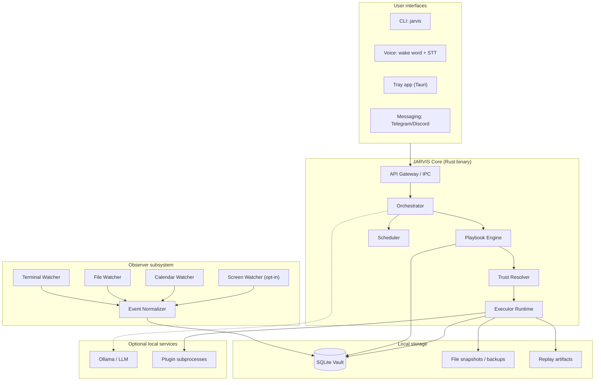
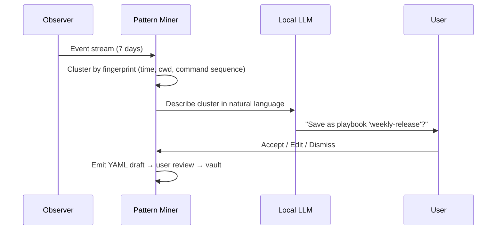

# PSEUDO-JARVIS Architecture

This document defines the technical architecture, data model, security model, and implementation plan for **Ambient Playbooks**.

**Status:** Design (Phase 0)  
**Last updated:** 2026-08-06

---

## Table of contents

1. [Design goals](#1-design-goals)
2. [System overview](#2-system-overview)
3. [Component architecture](#3-component-architecture)
4. [Data model](#4-data-model)
5. [Playbook engine](#5-playbook-engine)
6. [Trust & security model](#6-trust--security-model)
7. [Observer pipeline](#7-observer-pipeline)
8. [LLM integration](#8-llm-integration)
9. [Replay Theater](#9-replay-theater)
10. [Plugin system](#10-plugin-system)
11. [Deployment topology](#11-deployment-topology)
12. [Tech stack rationale](#12-tech-stack-rationale)
13. [MVP implementation plan](#13-mvp-implementation-plan)
14. [Future phases](#14-future-phases)
15. [Open questions](#15-open-questions)

---

## 1. Design goals

### Primary goals

| Goal | Metric |
|------|--------|
| **Local-first** | Zero network egress in default mode; CI-enforced |
| **Trustworthy** | Every action logged; destructive ops require confirm by default |
| **Learnable** | Repeated workflows become playbooks with minimal user effort |
| **Portable** | Single-user vault; copy `~/.jarvis/` to migrate machines |
| **Inspectable** | Open source; playbook YAML is human-readable |

### Non-goals (for MVP)

- Multi-user / team sync server  
- Cloud-hosted "brain"  
- Autonomous goal-seeking without user-defined playbooks  
- Replacing IDEs or full OS automation (we complement them)  

### Design principles

1. **Paranoid defaults** — deny > confirm > auto  
2. **Explicit consent** — observation scopes are directory- and app-granular  
3. **Reversibility** — backup before mutate; replay enables audit  
4. **Separation of concerns** — Observer records; Engine plans; Executor acts  
5. **Model-agnostic** — LLM is optional for matching triggers, not required for execution  

---

## 2. System overview



### Process model

```
jarvisd          # long-running daemon (observer + scheduler + IPC server)
jarvis           # CLI client (talks to jarvisd via Unix socket / named pipe)
jarvis-tray      # optional Tauri UI (system tray, consent controls, replay viewer)
```

Single machine. One vault. Daemon starts at login (optional), user-controlled.

---

## 3. Component architecture

### 3.1 API Gateway

**Responsibility:** Unified entry for CLI, voice, tray, and messaging adapters.

| Transport | MVP | v1 |
|-----------|-----|-----|
| Unix domain socket | ✅ | ✅ |
| HTTP localhost (127.0.0.1) | ❌ | ✅ (for tray + plugins) |
| gRPC | ❌ | Optional |

**Request flow:**

```
Client → authenticate (local token) → route → Orchestrator → response
```

Local auth token generated at `jarvis init`, stored in `~/.jarvis/auth.token` with `0600` permissions. No remote auth.

### 3.3 Orchestrator

Central coordinator. Responsibilities:

- Resolve natural-language intent → playbook name (via LLM or exact phrase match)  
- Load playbook version from vault  
- Build execution plan (topological sort of steps, handle `depends_on`)  
- Invoke Trust Resolver before each step  
- Emit events for Replay Theater  
- Handle pause/resume/cancel  

**State machine per run:**

```
PENDING → RUNNING → (PAUSED) → COMPLETED | FAILED | CANCELLED
```

### 3.4 Playbook Engine

Parses, validates, and versions playbooks.

- **Format:** YAML (see [§5](#5-playbook-engine))  
- **Validation:** JSON Schema + semantic checks (no paths outside allowlist)  
- **Versioning:** Git-friendly; vault stores `playbook_id + version + content_hash`  
- **Diff:** `jarvis playbook diff v2 v3` for human review  

### 3.5 Executor Runtime

Runs individual step types in **sandboxed contexts**:

| Step type | Sandbox | MVP |
|-----------|---------|-----|
| `shell` | Restricted env, cwd allowlist, timeout | ✅ |
| `file-read` | Path allowlist | ✅ |
| `file-write` | Path allowlist + pre-backup | ✅ |
| `file-transform` | Same as write | ✅ |
| `draft-email` | Write to drafts dir only until confirm | ✅ |
| `http-local` | localhost only | ❌ v2 |
| `plugin` | Subprocess + capability token | ❌ v2 |

**Shell restrictions (MVP):**

- No `sudo` unless explicitly in playbook metadata `elevated: true` + user confirm  
- Blocklist: `rm -rf /`, fork bombs, curl to non-localhost (default)  
- `JARVIS_RUN_ID` env var injected for audit  
- Max runtime per step: configurable (default 5 min)  

### 3.6 Scheduler

Cron + calendar triggers using `tokio-cron-scheduler`.

- Triggers create a **pending run** with `confirm` trust unless playbook marked `schedule_trust: auto`  
- Morning digest: "3 playbooks ready — approve?"  

### 3.7 Observer subsystem

See [§7](#7-observer-pipeline).

### 3.8 Replay Theater

See [§9](#9-replay-theater).

---

## 4. Data model

### 4.1 Vault layout

```
~/.jarvis/
├── config.toml           # user preferences, allowlists, LLM endpoint
├── auth.token            # local API auth
├── vault.db              # SQLite primary store
├── playbooks/            # YAML source of truth (synced to DB)
│   ├── monthly-close.yaml
│   └── community/        # imported templates
├── backups/              # pre-mutation file snapshots per run
│   └── run_<uuid>/
├── replays/              # structured logs + optional WebM
│   └── run_<uuid>/
├── observer/             # raw event buffer (rotated)
└── secrets/              # OS keychain refs or encrypted blobs
```

### 4.2 SQLite schema (core tables)

```sql
-- Observed events (append-only, rotated)
CREATE TABLE events (
    id            INTEGER PRIMARY KEY,
    ts            TEXT NOT NULL,          -- ISO8601 UTC
    source        TEXT NOT NULL,          -- terminal | filesystem | calendar | screen
    kind          TEXT NOT NULL,          -- command | file_create | file_modify | ...
    payload_json  TEXT NOT NULL,
    session_id    TEXT,
    redacted      INTEGER DEFAULT 0
);

-- Playbook registry
CREATE TABLE playbooks (
    id            TEXT PRIMARY KEY,       -- slug: monthly-close
    version       INTEGER NOT NULL,
    content_hash  TEXT NOT NULL,
    yaml_path     TEXT NOT NULL,
    created_at    TEXT NOT NULL,
    source        TEXT DEFAULT 'user',    -- user | suggested | community
    UNIQUE(id, version)
);

-- Execution runs
CREATE TABLE runs (
    id            TEXT PRIMARY KEY,       -- UUID
    playbook_id   TEXT NOT NULL,
    playbook_ver  INTEGER NOT NULL,
    status        TEXT NOT NULL,
    trigger       TEXT NOT NULL,          -- cli | voice | schedule | suggest
    started_at    TEXT,
    finished_at   TEXT,
    error         TEXT
);

-- Per-step run log
CREATE TABLE run_steps (
    id            INTEGER PRIMARY KEY,
    run_id        TEXT NOT NULL REFERENCES runs(id),
    step_id       TEXT NOT NULL,
    trust_level   TEXT NOT NULL,
    status        TEXT NOT NULL,
    input_json    TEXT,
    output_json   TEXT,
    started_at    TEXT,
    finished_at   TEXT
);

-- Trust overrides (user grants)
CREATE TABLE trust_grants (
    playbook_id   TEXT,
    step_id       TEXT,
    level         TEXT NOT NULL,          -- confirm | auto | deny
    granted_at    TEXT,
    PRIMARY KEY (playbook_id, step_id)
);

-- Pattern clusters (for suggester, Phase 2)
CREATE TABLE patterns (
    id            TEXT PRIMARY KEY,
    fingerprint   TEXT NOT NULL,
    event_ids     TEXT NOT NULL,          -- JSON array
    suggested_name TEXT,
    confidence    REAL,
    status        TEXT DEFAULT 'pending'  -- pending | accepted | dismissed
);
```

### 4.3 Event retention

| Data | Default retention | User override |
|------|-------------------|---------------|
| Raw observer events | 30 days | `retention_days` in config |
| Run replays | Forever | `jarvis replay prune` |
| File backups | 7 days post-run | per-playbook `backup_retention` |

---

## 5. Playbook engine

### 5.1 Playbook schema (YAML)

```yaml
apiVersion: jarvis.dev/v1
kind: Playbook
metadata:
  name: monthly-close
  description: Export Q4 report, categorize invoices, draft accountant email
  tags: [finance, monthly]
  author: bhuvan

spec:
  triggers:
    phrases:
      - "monthly close"
      - "do the friday thing"
    schedule: "0 17 * * 5"       # optional cron
    calendar:                     # optional
      - title_contains: "Month end"

  defaults:
    trust: confirm               # default for steps without explicit trust
  schedule_trust: confirm        # runs triggered by cron

  allow_paths:
    - ~/Documents/finance
    - ~/Downloads/invoices

  steps:
    - id: export-report
      name: Export Q4 CSV
      type: shell
      trust: auto
      cwd: ~/Documents/finance
      command: ./scripts/export-q4.sh
      timeout: 120s

    - id: categorize-invoices
      name: Rename invoice files
      type: file-transform
      trust: auto
      depends_on: [export-report]
      config:
        glob: ~/Downloads/invoices/*.pdf
        rename: "{date}_{vendor}.pdf"

    - id: draft-email
      name: Draft email to accountant
      type: draft-email
      trust: confirm
      depends_on: [categorize-invoices]
      config:
        to: accountant@example.com
        subject: "Q4 close — {{ date }}"
        body_template: playbooks/monthly-close/email.md
        attachments_glob: ~/Downloads/invoices/*.pdf
```

### 5.2 Step types (extensible)

```rust
enum StepType {
    Shell,
    FileRead,
    FileWrite,
    FileTransform,
    DraftEmail,
    HttpLocal,      // v2
    Plugin,         // v2
    LlmTransform,   // v2 — summarize, classify (local model)
}
```

### 5.3 Variable interpolation

- `{{ date }}`, `{{ run_id }}`, `{{ step.export-report.output_path }}`  
- Resolved at runtime by Orchestrator; no arbitrary code eval  

### 5.4 Playbook suggestion flow (Phase 2)



**Fingerprinting (no LLM required for clustering):**

- Normalize commands (`git pull` → `git pull`)
- Bucket timestamps (e.g., Friday 5pm ± 2h)
- Same cwd + 80% command sequence overlap → candidate cluster

LLM used only for **naming** and **YAML draft generation**, not for clustering.

---

## 6. Trust & security model

### 6.1 Trust levels

```rust
enum TrustLevel {
    Deny,      // never execute
    Observe,   // suggest only
    Confirm,   // block until user approves
    Auto,      // execute immediately
}
```

**Resolution order:**

1. Global deny patterns (e.g., `rm -rf`, `*:22` SSH keys)  
2. Step-level `trust` in playbook  
3. `trust_grants` table (user overrides)  
4. Playbook `defaults.trust`  
5. System default: `Confirm`  

### 6.2 Confirmation UX

**CLI:**

```
Step: draft-email (trust: confirm)
  To: accountant@example.com
  Subject: Q4 close — 2026-08-06
  Attachments: 12 files

  [y] approve  [n] skip  [e] edit  [a] abort run
```

**Tray:** Modal with diff preview; 60s timeout → skip step (not auto-approve).

### 6.3 Observation allowlists

```toml
# ~/.jarvis/config.toml
[observer]
enabled = true
kill_switch_file = "~/.jarvis/STOP"   # touch this file → observer halts

[observer.terminal]
enabled = true
shells = ["bash", "zsh", "fish"]

[observer.filesystem]
enabled = true
watch = ["~/Projects", "~/Documents/finance"]
ignore = ["**/.git/**", "**/node_modules/**"]

[observer.screen]
enabled = false   # opt-in only
apps = []         # e.g. ["Excel", "Google Chrome"]
```

### 6.4 Secret handling

- API keys → OS keychain (keyring crate): macOS Keychain, Secret Service, Windows Credential Manager  
- Playbooks reference secrets by name: `secret: gmail_oauth`  
- Replay logs **redact** secrets at write time (regex + known patterns)  
- Observer redacts: passwords, tokens, credit cards (configurable patterns)  

### 6.5 Threat model (summary)

| Threat | Mitigation |
|--------|------------|
| Malicious playbook YAML | Schema validation; no arbitrary code in YAML; shell sandbox |
| Compromised LLM output | LLM cannot execute; only suggests playbook drafts for user approval |
| Observer exfiltration | No network in default build; egress blocked at runtime |
| Local token theft | `0600` permissions; token only on localhost socket |
| Supply-chain playbook | Community templates signed (v2); `jarvis playbook verify` |

---

## 7. Observer pipeline

### 7.1 Event sources

| Source | Implementation | MVP |
|--------|----------------|-----|
| Terminal | Shell precmd/preexec hooks → Unix socket to jarvisd | ✅ |
| Filesystem | `notify` crate (inotify/FSEvents/ReadDirectoryChangesW) | ✅ |
| Calendar | caldav/local DB (platform-specific) | ❌ Phase 3 |
| Screen | Tauri + platform APIs; OCR via `tesseract` or local vision model | ❌ Phase 4 |

### 7.2 Terminal hook (example)

```bash
# Installed by `jarvis observe enable`
_jarvis_preexec() {
  jarvis-agent event terminal command "$1" --cwd "$PWD" --ts "$(date -u +%Y-%m-%dT%H:%M:%SZ)"
}
precmd_functions+=(_jarvis_preexec)   # zsh
```

### 7.3 Normalization

All events → canonical JSON:

```json
{
  "ts": "2026-08-06T14:30:00Z",
  "source": "terminal",
  "kind": "command",
  "session_id": "abc123",
  "payload": {
    "command": "git pull origin main",
    "cwd": "/home/user/acme",
    "exit_code": 0,
    "duration_ms": 1200
  }
}
```

### 7.4 Privacy controls

- `jarvis observe status` — shows what's being watched  
- `jarvis observe pause` — stop recording, daemon stays up  
- `jarvis vault export --redact` — export for debugging without secrets  
- `jarvis vault destroy` — secure delete entire vault  

---

## 8. LLM integration

### 8.1 Role of the LLM

The LLM is **not** the executor. It is used for:

| Use case | Required? | Phase |
|----------|-----------|-------|
| Phrase → playbook mapping | Optional (exact match works) | MVP |
| Playbook draft from pattern cluster | Yes for suggester | Phase 2 |
| Natural-language step edits | Nice-to-have | Phase 3 |
| Email body polish | Optional per step | Phase 2 |

### 8.2 Provider abstraction

```rust
trait LlmProvider {
    async fn complete(&self, prompt: &str, opts: CompleteOpts) -> Result<String>;
}

// Implementations:
// - OllamaProvider (default) — http://127.0.0.1:11434
// - OpenAiCompatibleProvider — any OpenAI API shape (local or cloud, user opt-in)
```

### 8.3 Prompt boundaries

- System prompt: "You output YAML or JSON only. Never shell commands outside playbook schema."  
- User data never leaves machine when using Ollama  
- Cloud providers require explicit `config.toml` opt-in + warning on first use  

### 8.4 Recommended local models (2026)

| Task | Model | Size |
|------|-------|------|
| Trigger matching | `llama3.2:3b` or `qwen2.5:3b` | ~2GB |
| Playbook drafting | `qwen2.5:7b` or `mistral:7b` | ~4–5GB |
| Voice (STT) | `whisper-base` or `faster-whisper small` | ~150MB |

---

## 9. Replay Theater

### 9.1 Artifacts per run

```
~/.jarvis/replays/run_<uuid>/
├── manifest.json       # run metadata, playbook ref, timing
├── steps.jsonl         # one JSON object per step (append-only)
├── files.diff          # unified diff of all file changes
├── backups/            # copies before mutation
└── capture.webm        # optional screen recording (Phase 4)
```

### 9.2 manifest.json

```json
{
  "run_id": "550e8400-e29b-41d4-a716-446655440000",
  "playbook": { "id": "monthly-close", "version": 3 },
  "trigger": "voice",
  "phrase": "do the friday thing",
  "status": "completed",
  "started_at": "2026-08-06T17:00:00Z",
  "finished_at": "2026-08-06T17:02:14Z",
  "steps_total": 3,
  "steps_failed": 0,
  "trust_prompts": 1
}
```

### 9.3 Viewer (Phase 2+)

- CLI: `jarvis replay show <run_id>` — terminal UI  
- Tray: timeline scrubber, step detail, file diff pane  
- Export: `jarvis replay export --format markdown` for compliance  

---

## 10. Plugin system

### 10.1 Design (Phase 4+)

Plugins run as **isolated subprocesses** with capability tokens:

```yaml
# plugins/gmail/plugin.yaml
name: gmail
version: 1.0.0
capabilities: [network:gmail.googleapis.com, secrets:gmail_oauth]
entrypoint: ./gmail-plugin
```

Orchestrator spawns plugin with:

- Limited env vars  
- No filesystem access outside `~/.jarvis/plugins/gmail/`  
- IPC via stdin/stdout JSON lines  
- User must `jarvis plugin enable gmail` explicitly  

### 10.2 Planned plugins

| Plugin | Capability |
|--------|------------|
| gmail | Draft/send via OAuth |
| notion | Create/update pages |
| jira | Create issues from playbook steps |
| home-assistant | Trigger automations |
| slack | Post messages (webhook) |

---

## 11. Deployment topology

### 11.1 Single-machine (default)

```
┌──────────────────────────────────────┐
│  Your laptop / desktop               │
│  ┌────────┐  ┌─────────┐  ┌───────┐  │
│  │ jarvisd│  │ Ollama  │  │ Vault │  │
│  └────────┘  └─────────┘  └───────┘  │
└──────────────────────────────────────┘
```

### 11.2 Optional: home server + phone

```
┌─────────────┐         ┌──────────────────┐
│  Phone      │ Telegram│  Home server     │
│  (trigger)  │────────▶│  jarvisd + Ollama│
└─────────────┘         │  (same vault)    │
                        └──────────────────┘
```

Messaging adapter is a **thin client** — brain stays on the machine that holds the vault. No cloud relay.

### 11.3 Resource requirements

| Profile | RAM | Disk | GPU |
|---------|-----|------|-----|
| Minimal (no LLM) | 256 MB | 500 MB | — |
| Standard (3B model) | 4 GB | 2 GB | Optional |
| Full (7B + voice) | 8 GB | 5 GB | Recommended |

---

## 12. Tech stack rationale

### Core: Rust

- Long-running daemon with low memory  
- `notify`, `tokio`, `rusqlite`, `serde` ecosystem is mature  
- Single static binary for `jarvis` / `jarvisd`  
- Memory safety for security-sensitive observer  

**Workspace layout (planned):**

```
pseudo-jarvis/
├── crates/
│   ├── jarvis-core/       # orchestrator, playbook engine, trust
│   ├── jarvis-observer/   # event sources, normalizer
│   ├── jarvis-executor/   # step runners, sandbox
│   ├── jarvis-llm/        # provider trait + ollama
│   ├── jarvis-cli/        # clap CLI
│   ├── jarvis-daemon/     # jarvisd entrypoint
│   └── jarvis-tray/       # Tauri app (Phase 3)
├── playbooks/community/   # template playbooks
├── docs/
└── tests/
```

### SQLite

- One file to backup/sync  
- WAL mode for concurrent observer writes + CLI reads  
- FTS5 for searching replay logs  

### Tauri 2 (Phase 3)

- Rust backend shares crates with daemon  
- Small binary vs Electron  
- Native tray, notifications, permission prompts  

### Voice pipeline

```
Wake word (openWakeWord / Porcupine custom) 
  → faster-whisper (STT) 
  → Orchestrator 
  → Piper/Kokoro (TTS) optional confirmation readback
```

All local. Wake word optional — push-to-talk in MVP.

### Alternatives considered

| Choice | Alternative | Why we passed |
|--------|-------------|---------------|
| Rust | Python | Daemon longevity, sandbox safety; Python for plugins instead |
| SQLite | PostgreSQL | Overkill for single-user local |
| YAML playbooks | Pure code | Non-devs must read/edit workflows |
| Tauri | Electron | Size, memory, Rust code sharing |
| Custom IPC | gRPC everywhere | Unix socket simpler for MVP |

---

## 13. MVP implementation plan

### Phase 1 milestones (8–12 weeks estimated effort)

#### Milestone 1.1 — Scaffold (week 1–2)

- [ ] Cargo workspace + `jarvis-core` types  
- [ ] SQLite migrations  
- [ ] Config loader (`config.toml`)  
- [ ] Local IPC (Unix socket)  

#### Milestone 1.2 — Playbook engine (week 3–4)

- [ ] YAML parser + JSON Schema validation  
- [ ] Topological step sort  
- [ ] `jarvis playbook validate|list|show`  

#### Milestone 1.3 — Executor (week 5–6)

- [ ] Shell step with sandbox  
- [ ] File read/write/transform  
- [ ] Draft-email (writes to `~/Mail/drafts/` or local mbox)  
- [ ] Trust resolver + CLI confirm prompt  

#### Milestone 1.4 — Observer (week 7–8)

- [ ] Filesystem watcher  
- [ ] Shell hook installer  
- [ ] Event → SQLite pipeline  
- [ ] `jarvis observe enable|status|pause`  

#### Milestone 1.5 — Orchestration + replay (week 9–10)

- [ ] `jarvis run <playbook>` end-to-end  
- [ ] Replay manifest + steps.jsonl  
- [ ] File backup + diff  

#### Milestone 1.6 — LLM trigger (week 11–12)

- [ ] Ollama provider  
- [ ] Phrase → playbook routing  
- [ ] CI: no-network integration tests  
- [ ] Example community playbooks  

### MVP acceptance criteria

1. User can define a 3-step playbook in YAML  
2. User can run it via `jarvis run monthly-close`  
3. Confirm gate blocks email step until approved  
4. Replay log exists and lists every action  
5. Observer records terminal + file events in allowlisted dirs  
6. Default build makes zero outbound network connections  

---

## 14. Future phases

### Phase 2 — Pattern suggester

- Fingerprint clustering on 7-day event window  
- LLM-generated YAML drafts  
- `jarvis suggest` TUI to accept/edit/dismiss  

### Phase 3 — Voice + tray

- Tauri tray app with kill switch  
- Wake word or push-to-talk  
- Visual replay viewer  

### Phase 4 — Plugins + community registry

- Plugin host + Gmail/Notion  
- `playbooks/community/` curated templates  
- Signed template bundles  

### Phase 5 — Cross-device

- Encrypted vault sync (user's iCloud/Drive — same pattern as Cortex)  
- Phone as trigger only, not second brain  

---

## 15. Open questions

Track decisions in GitHub Discussions.

| # | Question | Options | Lean |
|---|----------|---------|------|
| 1 | Default license for community playbooks | CC0 vs MIT | CC0 for templates |
| 2 | Screen observer in v1 or v2? | v1 risky for trust | Phase 4 |
| 3 | Email delivery in MVP | Draft-only vs SMTP send | Draft-only |
| 4 | Windows support in MVP | Yes (complex) vs macOS/Linux first | macOS + Linux first |
| 5 | Playbook signing | Optional vs required for community | Optional in v1, required in registry |

---

## Appendix A — Example community playbooks

See `playbooks/community/` (to be added in Phase 1):

- `dev-release.yaml` — git pull, test, tag, changelog  
- `weekly-standup-prep.yaml` — aggregate git log + open PRs → markdown  
- `invoice-pipeline.yaml` — download, rename, archive  

---

## Appendix B — Comparison matrix

| Capability | PSEUDO-JARVIS | Open Interpreter | OpenClaw | n8n/Zapier |
|------------|:-------------:|:----------------:|:--------:|:----------:|
| Local-first | ✅ | ✅ | Partial | ❌ |
| Learns workflows | ✅ | ❌ | ❌ | Manual |
| Trust ladder | ✅ | ❌ | Partial | ❌ |
| Replay audit | ✅ | Partial | ❌ | Logs only |
| No-code friendly | Playbooks | Code | Chat | GUI |
| Open source | ✅ | ✅ | ✅ | Partial |

---

*This is a living document. Open a PR to propose changes.*
